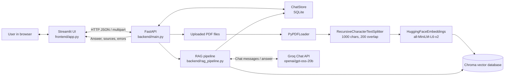
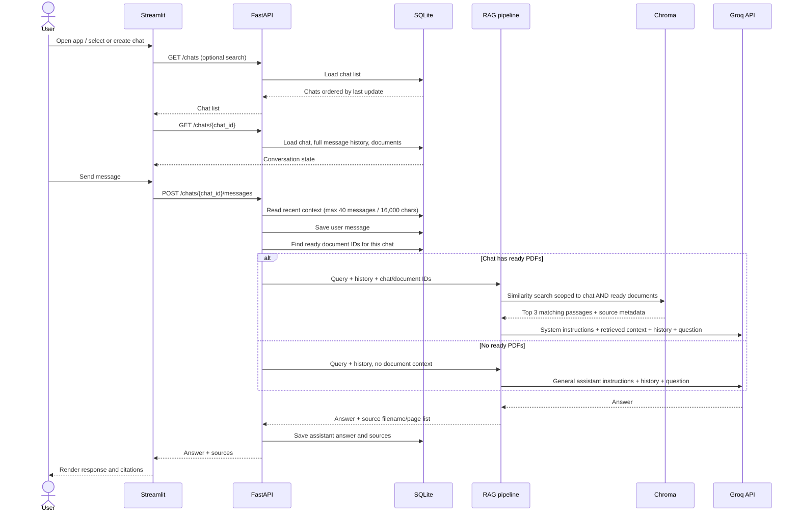
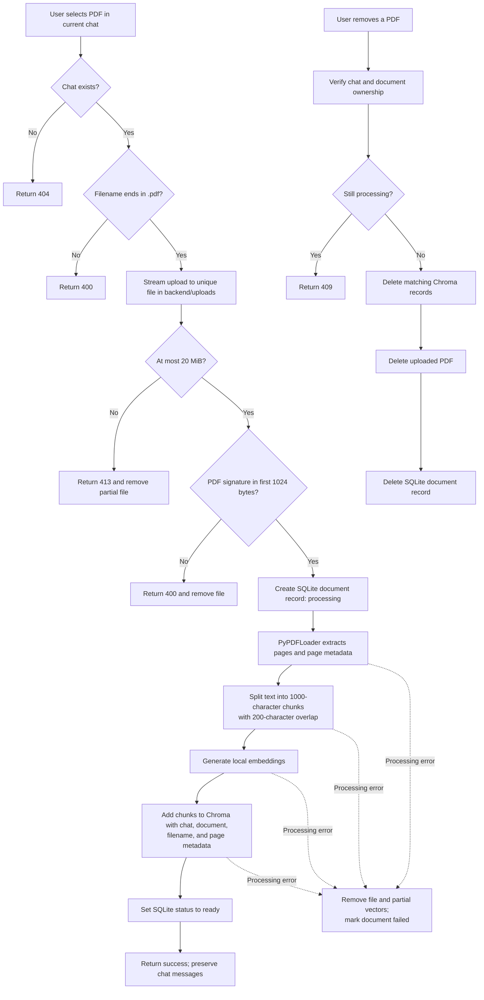

# Lexi-RAG

Lexi-RAG is a local, single-user conversational assistant. It supports regular
chat without a document, persistent conversations, and optional PDF-grounded
answers with source filenames and page numbers. PDFs belong to an individual
chat; adding one does not erase that chat's existing messages.

## Features

- Create, search, rename, switch between, and delete saved chats.
- Persist chat messages and document metadata in SQLite.
- Chat with the LLM without uploading a PDF.
- Upload PDFs to a chat at any time and keep its existing history.
- Retrieve passages only from ready PDFs attached to the current chat.
- Display source filename and page for retrieved passages.
- Remove an individual PDF, including its uploaded file and vector records.
- Limit uploaded PDFs to 20 MiB and validate their extension and PDF signature.
- Keep complete message history on disk while sending at most the latest 40
  messages and 16,000 characters to the model for context.

## Architecture



### Local data and ownership

| Data | Location | Purpose |
| --- | --- | --- |
| Chats, messages, document records | `backend/chat_data.sqlite3` | Durable conversation and document metadata |
| Uploaded PDFs | `backend/uploads/<document-id>.pdf` | Original PDFs associated with chats |
| Text chunks and embeddings | `backend/chroma_db/` | Persistent vector index used for retrieval |
| Groq credentials | Root `.env` file | API authentication; do not commit this file |

SQLite stores each document's chat ID, original filename, stored path, status,
and unique document ID. Each Chroma chunk stores the chat ID, document ID, source
filename, and PDF page metadata. Those IDs let retrieval and deletion target
only the selected chat or document. Runtime data directories and `.env` are
ignored by Git.

## What happens during a conversation



The whole conversation is saved; context sent to Groq is intentionally bounded
to the most recent messages and character budget. There is no automatic
summarization yet. An ordinary chat sends no vector retrieval request. If a chat
has PDFs but no relevant passages are retrieved, the assistant is instructed
not to invent document-based facts.

## What happens during PDF upload and removal



PDF processing currently runs synchronously in the upload request. The API
rejects files larger than 20 MiB, non-`.pdf` filenames, and files without a PDF
signature. `PyPDFLoader` extracts text; scanned/image-only PDFs may need OCR,
which is not implemented. If PDF parsing, splitting, embedding, or vector
indexing fails, the request returns an error and the document is not marked
ready for retrieval.

## Requirements

- Python 3.10 or later (the project has been used with Python 3.10).
- Conda is optional; use the same Python environment for dependency installation,
  FastAPI, and Streamlit.
- A Groq API key with access to the configured model.
- Internet access for Groq requests and the first download of the local
  Hugging Face embedding model.

## Setup and run

From the repository root, activate your Conda environment if using one, then
install dependencies into that environment:

```bash
conda activate ml-env
python -m pip install -r backend/requirements.txt
```

Create a root-level `.env` file and add your Groq API key:

```dotenv
GROQ_API_KEY=your_groq_api_key
```

Keep the real key private. `.env` is ignored by Git; do not paste it into source
files or commit it.

Start the backend and frontend in **two separate terminals**, both using the
same Python environment:

**Terminal 1 — FastAPI**, from the repository root:

```bash
cd backend
python -m uvicorn main:app --reload
```

The API is available at `http://127.0.0.1:8000`; interactive API documentation
is at `http://127.0.0.1:8000/docs`.

**Terminal 2 — Streamlit**, from the repository root:

```bash
streamlit run frontend/app.py
```

Streamlit prints the local browser URL (usually `http://localhost:8501`). Keep
the backend running while using the UI; the frontend calls the API at
`http://127.0.0.1:8000`.

## Using the application

1. Open the Streamlit URL. The app loads saved conversations and creates a new
   chat if none exist.
2. Select **＋ New chat** to start a separate conversation. The first message
   becomes its title; rename it in **Chat settings** if needed.
3. Send a message without uploading a file to use normal assistant chat.
4. To ground responses in a PDF, choose a file in **Add context to this chat**
   and click **Add PDF to chat**. Existing messages remain saved and visible.
5. View attached files and their processing state in the conversation. Use
   **Manage attached PDFs** to remove a file.
6. Use **Search chats** to find conversations by title or saved message text.
7. Use **Chat settings** to rename or delete a conversation. Deleting a chat
   also removes its associated PDF files and vector records.

Conversation history persists across Streamlit reruns and process restarts
because it is stored in SQLite, not only in Streamlit session state.

## HTTP API

All endpoints are served by FastAPI at `http://127.0.0.1:8000`.

| Method | Endpoint | Description |
| --- | --- | --- |
| `GET` | `/chats?search=term` | List chats; optional case-insensitive title/message search |
| `POST` | `/chats` | Create a chat; optional JSON body `{"title":"New chat"}` |
| `GET` | `/chats/{chat_id}` | Get chat metadata, all messages, and attached documents |
| `PATCH` | `/chats/{chat_id}` | Rename using JSON body `{"title":"..."}` |
| `DELETE` | `/chats/{chat_id}` | Delete chat, its documents, and vectors |
| `POST` | `/chats/{chat_id}/messages` | Send JSON body `{"content":"..."}` and save the answer |
| `POST` | `/chats/{chat_id}/documents` | Upload a multipart PDF field named `file` |
| `DELETE` | `/chats/{chat_id}/documents/{document_id}` | Remove one attached PDF and its vectors |

Example requests:

```bash
curl http://127.0.0.1:8000/chats

curl -X POST http://127.0.0.1:8000/chats \
  -H 'Content-Type: application/json' \
  -d '{"title":"Study session"}'

curl -X POST http://127.0.0.1:8000/chats/CHAT_ID/messages \
  -H 'Content-Type: application/json' \
  -d '{"content":"Explain gradient descent"}'

curl -X POST http://127.0.0.1:8000/chats/CHAT_ID/documents \
  -F 'file=@notes.pdf'
```

Replace `CHAT_ID` with the ID returned by `POST /chats`.

## Tests

Run backend, API, storage, and RAG tests from the backend directory:

```bash
cd backend
python -m unittest discover -s tests -v
```

Tests use temporary SQLite/vector-independent fixtures and mock external model
and PDF processing calls where appropriate. Real answers require a working
Groq key; first-time PDF ingestion downloads/loads the local embedding model.

## Current scope and limitations

- Local, single-user application; there is no login, user isolation, or
  synchronization between machines.
- SQLite and Chroma are local stores. Back up `backend/chat_data.sqlite3`,
  `backend/chroma_db/`, and `backend/uploads/` together to preserve conversations
  and document retrieval.
- Model context is bounded by recent message count and characters; full-history
  summarization is not implemented.
- PDF ingestion is synchronous and text extraction does not include OCR.
- The Groq model ID is configured in `backend/rag_pipeline.py`; model access and
  availability depend on the Groq account.
